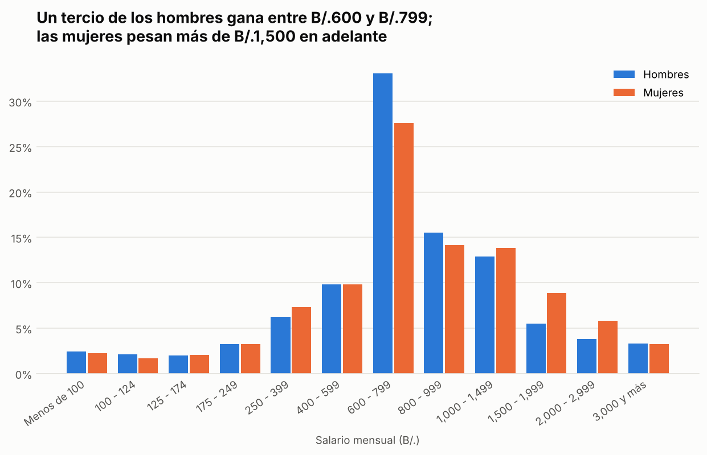
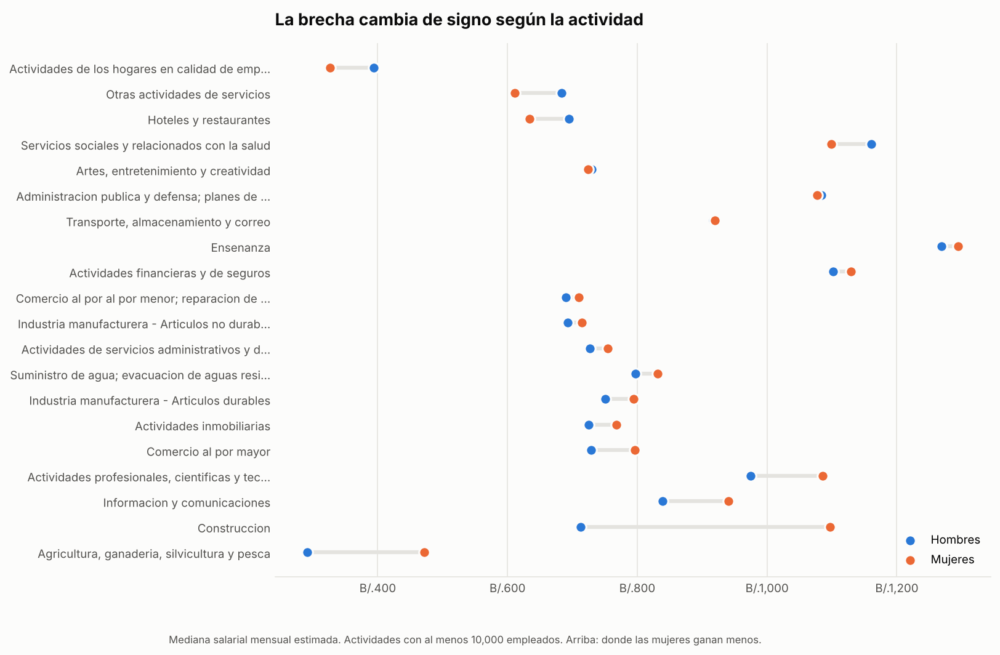
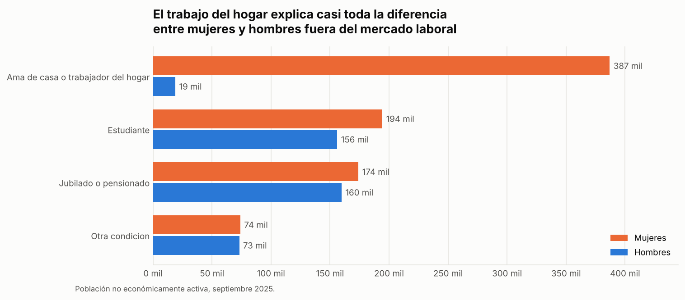
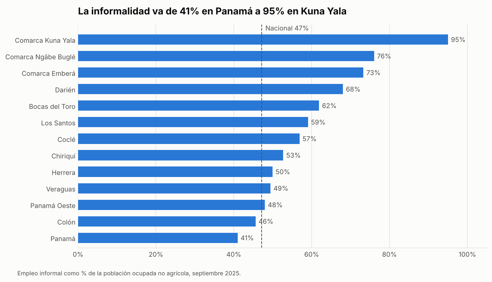

# Mercado laboral en Panamá: salarios, informalidad e inactividad

Análisis de tres cuadros de la Encuesta de Mercado Laboral del INEC para responder una pregunta:
**¿dónde está la desigualdad entre hombres y mujeres en el mercado laboral panameño: en lo que ganan, en la calidad del empleo o en quién llega a trabajar?**

📓 [Ver el notebook con el análisis completo](notebooks/analisis_mercado_laboral_panama.ipynb)

## Hallazgos

**1. Entre personas empleadas, la mediana salarial de las mujeres no es menor.**
La mediana mensual estimada es de B/.771 para mujeres y B/.746 para hombres. Un 33% de los hombres gana entre B/.600 y B/.799; en cambio, el 18% de las mujeres empleadas gana B/.1,500 o más, frente al 13% de los hombres. Es un efecto de composición: las mujeres con empleo asalariado se concentran en enseñanza, salud, finanzas y sector público.



**2. La brecha sí aparece dentro de actividades feminizadas y de bajo salario.**
En servicio doméstico las mujeres ganan 17% menos que los hombres; en otros servicios, 11%; en hoteles y restaurantes, 9%.



**3. La mayor desigualdad es de acceso al mercado laboral.**
En septiembre de 2025 había unas 830 mil mujeres y 408 mil hombres fuera del mercado laboral (67% mujeres). Casi toda la diferencia viene de una categoría: ama de casa o trabajador del hogar, con 387 mil mujeres y 19 mil hombres.



**4. La informalidad es un problema territorial más que de género.**
El 47% del empleo no agrícola es informal (47.7% en 2024, 47.1% en 2025), con tasas parecidas para hombres y mujeres. Por territorio va de 41% en la provincia de Panamá a 68% en Darién y más de 70% en las comarcas.



## Datos

Fuente: Instituto Nacional de Estadística y Censo (INEC), Contraloría General de la República de Panamá — Encuesta de Mercado Laboral. Archivos descargados el 4 de marzo de 2026.

| Archivo en `data/raw/` | Cuadro | Contenido | Periodo |
|---|---|---|---|
| `cuadro_25_empleados_por_salario.csv` | 25 | Empleados y % por tramo de salario mensual, por provincia, sexo y actividad | no viene indicado en el archivo |
| `cuadro_29_poblacion_no_economicamente_activa.csv` | 29 | Población no económicamente activa por condición, área/provincia y sexo | oct. 2024 y sep. 2025 |
| `cuadro_39_empleo_informal.csv` | 39 | Empleo informal no agrícola por provincia y sexo | 2024 y 2025 |

## Método

- **Limpieza:** cada cuadro se pasa a formato largo y se unifican los nombres de provincias, que cada cuadro escribe distinto.
- **Mediana salarial:** el cuadro 25 no trae salarios individuales sino porcentajes por tramo. Se convierten a personas por tramo y se estima la mediana por interpolación lineal dentro del tramo (mediana de datos agrupados).
- **Brecha:** `1 − mediana mujeres / mediana hombres`. Positiva cuando las mujeres ganan menos.
- **Tasa de informalidad:** empleo informal (en empresas formales, informales y hogares) ÷ población ocupada no agrícola.

## Limitaciones

- Los salarios vienen en tramos con porcentajes redondeados: la mediana es una estimación propia, no una cifra publicada por el INEC.
- El cuadro 25 solo cubre empleados (asalariados); no incluye trabajadores por cuenta propia.
- No se controla por horas, ocupación, educación ni antigüedad: las brechas son descriptivas, no causales.
- Son estimaciones de una encuesta por muestreo; las celdas pequeñas (comarcas, actividades con pocos empleados) tienen mucho error.

## Estructura

```
data/raw/      cuadros del INEC tal como se descargaron
src/           mercado_laboral.py (carga y métricas) y graficos.py
notebooks/     análisis comentado, con resultados
figuras/       gráficos generados por el notebook
tests/         pruebas de las métricas y de la consistencia de los datos
```

## Cómo reproducirlo

```bash
pip install -r requirements.txt
pytest                      # valida métricas y datos
jupyter notebook notebooks/analisis_mercado_laboral_panama.ipynb
```

## Autor

Gerthmay Clair — [GitHub](https://github.com/gerthmayac-create)
